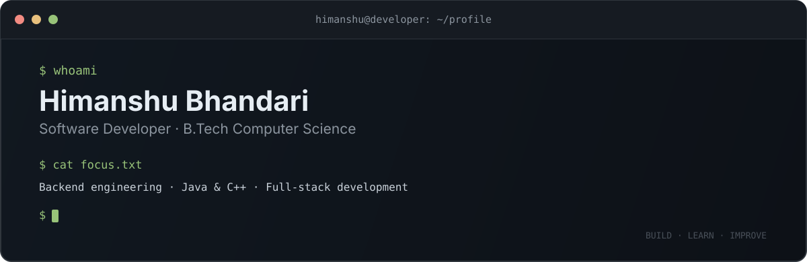

<div align="center">



<br/>

<a href="https://github.com/rookanshu">
  
</a>
<a href="https://www.linkedin.com/in/himanshu-bhandari-b2b18243a/">
  
</a>
<a href="https://himanshu-bhandari-portfolio.vercel.app/">
  
</a>

</div>

---

## `$ whoami`

I'm **Himanshu Bhandari**, a Computer Science undergraduate interested in building useful software and reliable backend systems.

- 🎓 B.Tech in Computer Science Engineering
- 💻 Interested in software engineering and backend development
- 🌱 Strengthening Java, C++, data structures and algorithms
- 🧩 Building full-stack applications and API-driven projects
- 🐧 Comfortable working in Linux development environments

## `$ ls ./toolkit`

**Languages**

<p>
  
</p>

**Frontend**

<p>
  
</p>

**Backend & data**

<p>
  
</p>

**Tools**

<p>
  
</p>

## `$ ls ./projects`

| Project | What it does | Stack |
|---|---|---|
| [NER Logistics](https://ner-lifeline.vercel.app) | Route intelligence for disrupted mountain routes, with alternate corridors, ETA and hazard analysis. | Next.js, React, TypeScript, FastAPI, WebSockets |
| [SIH 2026](https://github.com/rookanshu/SIH-26) · [Live](https://sih-26-plum.vercel.app) | Smart logistics and accessibility intelligence platform developed for a hackathon problem statement. | Next.js, React, TypeScript |
| [Portfolio](https://proof-navy.vercel.app) · [Source](https://github.com/rookanshu/Portfolio) | Personal portfolio showcasing selected development work. | React / web stack |

## `$ git status`

<div align="center">
  
  
  <br/>
  
</div>

## `$ connect`

- GitHub: [@rookanshu](https://github.com/rookanshu)
- LinkedIn: [Himanshu Bhandari](https://www.linkedin.com/in/himanshu-bhandari/)
- Portfolio: [proof-navy.vercel.app](https://proof-navy.vercel.app)

<div align="center">

```text
Thanks for stopping by.
Keep building. Keep learning.
```

</div>
